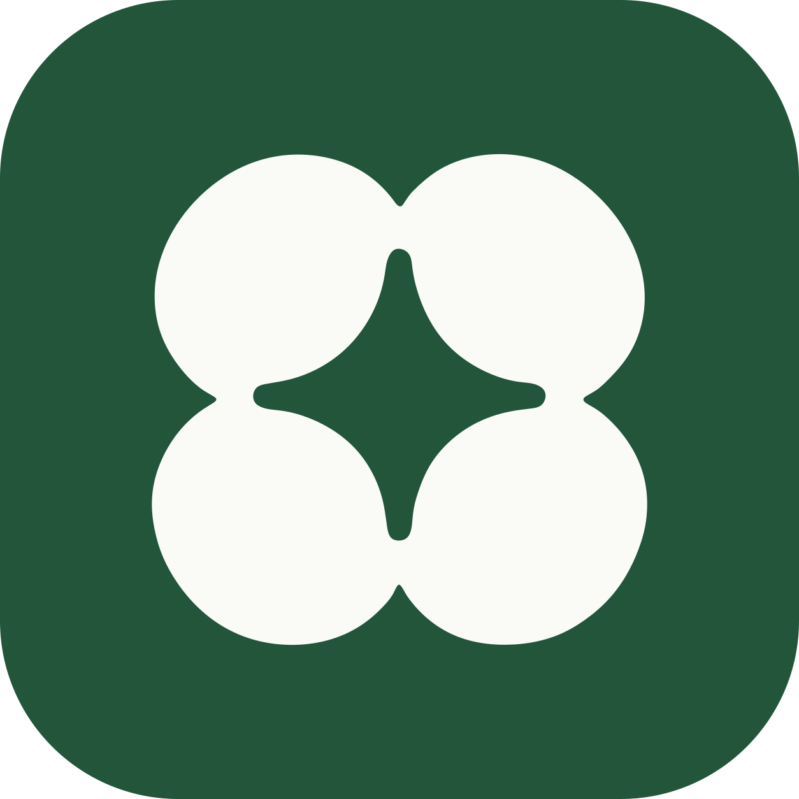

# Kiwi Calendar

**A self-hosted family calendar for Android wall displays.**

I built Kiwi Calendar because I wanted a wall calendar that did more than show a schedule. I wanted something I could run on an affordable Android display, customize myself, and keep using even when the internet was down.

The app puts a monthly calendar and daily agenda on the wall. When it's not in use, it turns into a photo frame with a clock, upcoming events, and scores for the teams I follow. Everything runs through a small Docker server at home, with a web interface that makes it easy to add events or manage photos from a phone.

One thing I cared about was making the tablet useful on its own. It keeps a local copy of its data, so the calendar still works if the server goes offline. Changes made on the tablet sync back when the connection returns.

## What it does

- **Calendar + agenda:** A month view with the selected day's events alongside it.
- **Add events from anywhere at home:** Use the tablet directly or scan its QR code to open the web interface on a phone.
- **Offline support:** The tablet stores its own data and queues offline edits for later sync.
- **Photo frame:** Switches to photos, a clock, and upcoming events when the calendar is idle.
- **Sports scores:** Shows updates for selected teams across supported leagues.
- **Calendar subscriptions:** Pulls in read-only events from iCal feeds, including Google Calendar.
- **Quiet hours:** Dims the display overnight and leaves a simple clock on screen.
- **Self-hosted backend:** Runs with Docker and stores everything locally using SQLite.

## How it works

The Android app handles the display and keeps its own local data. The backend handles events, calendar feeds, photos, and scores. A separate web interface lets phones and computers make changes without needing the Android app.

```text
 Phone / computer ── QR code ──► Web interface
                                     │
 Google Photos ──┐                   ▼
 iCal feeds ─────┼──────────► Kiwi server (Docker)
 ESPN scores ────┘                   ▲
                                     │
                            Kiwi Android app
                          (local offline copy)
```

The tablet checks for changes about every two minutes and does a full sync daily. The server also refreshes subscribed calendars and shared photos each day.

## Tech stack

| Part | Built with |
| --- | --- |
| Android app | Kotlin, Jetpack Compose; no Google Play services required |
| Backend | Python, FastAPI, SQLite |
| Web interface | Files in `server/app/static/` |
| Deployment | Docker Compose |
| CI/CD | GitHub Actions for APK builds, tests, and Docker images |

## Getting started

### 1. Set up the repository

Push the project to your GitHub repository. The workflows in `.github/workflows/` handle two things:

- **Android:** Builds an APK on push. Download it from the workflow's **Artifacts** section, or from **Releases** after pushing a version tag like `v1.0.0`.
- **Server:** Runs tests and publishes a container image to `ghcr.io/<your-user>/<your-repo>`.

GitHub Container Registry may make the package private initially. You can change its visibility from **Packages**, or authenticate on the machine running Docker with `docker login ghcr.io`.

**Important:** If you plan to keep the app installed and update it later, configure a permanent signing key before your first release. Otherwise, builds signed with different keys can't update one another. I've included the steps under [APK signing](#apk-signing).

### 2. Run the server

Any always-on machine on your home network should work, including a Raspberry Pi 4 or newer.

In `docker-compose.yml`:

- Set `image` to the image published by GitHub Actions, or use `build: ./server` to build locally.
- Set `TZ` to your time zone, such as `America/Chicago`.

Start it:

```sh
docker compose up -d
docker compose logs kiwi | grep "Access token"
```

The server runs on **port 8080**. I recommend reserving a local IP for the server in your router so the tablet always knows where to find it.

### 3. Install the Android app

Download the APK and install it directly on the display. You can also use ADB if USB debugging is enabled:

```sh
adb install kiwi-calendar-*.apk
```

When Kiwi Calendar opens, follow the setup screens to enter your server address (for example, `192.168.1.20:8080`) and access token. You can also pick your sports teams, set up photos, and choose when photo mode should start.

## Managing events

There are three ways to add events:

- **On the tablet:** Tap **Add**. You can also edit or delete events you created.
- **From a phone:** Tap **From phone** on the tablet and scan the QR code. Your phone remembers the connection afterward.
- **From a computer:** Open `http://<server>:8080` and enter the access token.

Changes from another device usually show up on the calendar within about two minutes. If you add an event while the tablet is offline, it gets queued until the server is available again.

### Connect an existing calendar

Open the web interface, go to **Calendars**, and add an iCal URL. For Google Calendar, open the calendar's settings on a computer and copy its **Secret address in iCal format**.

Subscribed events are read-only inside Kiwi Calendar. You still manage those events in their original calendar.

## Photos

I wanted photo mode to work with Google Photos, but changes to Google's library access in 2025 made direct album syncing more complicated. I included two options, and you can use them together.

### Option 1: Shared Google Photos album

This is the easiest approach:

1. Open an album in Google Photos.
2. Tap **Share** and create a link.
3. Paste that link into the web interface under **Photos**.

The server downloads and resizes the photos for the display. It checks the album again each night, so new photos can show up without manually uploading them to Kiwi.

This method reads the album's shared web page rather than an official Google API. It may need changes if Google updates that page. Also keep in mind that anyone with the album link can view it.

### Option 2: Google Photos Picker

This option uses Google's official Photos Picker API. You select the photos you want to import, and Kiwi downloads them once.

To set it up:

1. Create a project in the [Google Cloud console](https://console.cloud.google.com/).
2. Under **APIs & Services > Library**, enable the **Photos Picker API**.
3. Configure the OAuth consent screen in **Google Auth Platform**. Choose **External**, enter the required app details, and add your Google account under **Test users**.
4. Create an OAuth client using **TVs and Limited Input devices**. It uses a code-based sign-in, so the server doesn't need a public URL.
5. Add `GOOGLE_CLIENT_ID` and `GOOGLE_CLIENT_SECRET` to `docker-compose.yml`, then restart with `docker compose up -d`.
6. In the web interface's **Photos** tab, choose **Connect Google account**, enter the displayed code, and select **Pick photos**.

When Google's consent screen is in testing mode, the authorization expires after seven days. Photos already downloaded stay available; you only need to reconnect to select more.

## Sports scores

The photo screen can show scores for teams you select during setup or in Settings.

Supported leagues include NFL, college football, NBA, WNBA, men's and women's college basketball, MLB, NHL, MLS, Premier League, La Liga, and the Champions League.

For each team, Kiwi prioritizes a live game, then today's game, the latest result, or the next upcoming game. Scores refresh about every two minutes while photo mode is open.

Score data comes from ESPN's public site API. It works without a paid API key, but it's undocumented and could change.

## Photo mode, quiet hours, and startup

Photo mode starts after a period of inactivity (five minutes by default), or you can open it manually with **Photos**. Tap the screen to go back to the calendar.

Quiet hours dim the screen overnight and show a clock. Touching the display temporarily brings the calendar back.

For a dedicated wall display, there are a couple of Android settings worth checking:

- Turn on **Open automatically** in Kiwi's Settings and select it as the home app when Android asks. That allows it to reopen after a restart.
- Kiwi keeps the screen awake while the app is running.
- If your tablet stops background sync, set Kiwi Calendar's battery usage to **Unrestricted** in Android's app settings.

## Configuration

The server uses these environment variables:

| Variable | Default | What it controls |
| --- | --- | --- |
| `TZ` | `UTC` | Time zone for scheduled refreshes and calendar feeds |
| `KIWI_TOKEN` | Generated | Shared access token; saved in the data volume if one isn't provided |
| `SYNC_TIME` | `03:00` | Local time for the daily feed and album refresh; also refreshes at startup |
| `MAX_PHOTOS` | `500` | Maximum photos pulled from a shared album |
| `PHOTO_MAX_EDGE` | `1920` | Maximum length of a photo's longest edge after resizing |
| `GOOGLE_CLIENT_ID` | — | Google Photos Picker OAuth client ID |
| `GOOGLE_CLIENT_SECRET` | — | Google Photos Picker OAuth client secret |
| `KIWI_DATA` | `/data` | Location for the database, access token, and downloaded photos |

You can also trigger an immediate feed or album refresh from the web interface.

## APK signing

Android requires the same signing key when updating an installed app. Generate a keystore once:

```sh
keytool -genkeypair -v -keystore kiwi-calendar.jks -alias kiwi \
  -keyalg RSA -keysize 4096 -validity 10000

base64 -w0 kiwi-calendar.jks          # Linux
base64 -i kiwi-calendar.jks           # macOS
```

In the repository, go to **Settings > Secrets and variables > Actions** and add:

| Secret | Value |
| --- | --- |
| `KEYSTORE_BASE64` | Base64 output of the keystore |
| `KEYSTORE_PASSWORD` | Keystore password |
| `KEY_ALIAS` | `kiwi` |
| `KEY_PASSWORD` | Key password (often the same as the keystore password) |

**Back up `kiwi-calendar.jks` and don't commit it.** If you lose the key, future builds won't install over the existing app; you'll have to uninstall first.

## Building locally

### Android

You'll need JDK 17 and the Android SDK. Open `android/` in Android Studio, or run:

```sh
cd android
./gradlew assembleDebug
```

If you want a different Android package name, change `applicationId` in `android/app/build.gradle.kts`. You don't have to change the Kotlin `namespace`.

### Server

```sh
cd server
python -m venv .venv && . .venv/bin/activate
pip install -r requirements.txt -r requirements-dev.txt
python -m pytest
KIWI_DATA=./data TZ=America/Chicago uvicorn app.main:create_app --factory --reload --port 8080
```

## API reference

All endpoints except `/api/health` require an `Authorization: Bearer <token>` header.

| Endpoint | Purpose |
| --- | --- |
| `GET /api/revision` | Revision number that changes when events or photos change |
| `GET /api/sync` | Data for tablet sync: events from 31 days back to about a year ahead, plus photos |
| `GET /api/events?days=60` | Upcoming events |
| `POST /api/events` | Create an event |
| `PUT /api/events/{id}` | Create or replace an event with a client-selected ID |
| `DELETE /api/events/{id}` | Remove an event |
| `GET, POST /api/feeds` | List and add calendar feeds |
| `DELETE /api/feeds/{id}` | Remove a feed |
| `POST /api/feeds/refresh` | Refresh feeds |
| `GET /api/photos`, `GET /api/photos/{id}` | Photos and image files |
| `PUT, DELETE /api/photos/album` | Configure or remove a shared album |
| `POST /api/photos/album/refresh` | Refresh the shared album |
| `GET /api/google`, `POST /api/google/connect`, `POST /api/google/pick` | Google Photos Picker integration |
| `GET /api/sports/leagues`, `GET /api/sports/teams?league=nfl` | Sports leagues and teams |
| `GET /api/scores?teams=nfl:3,nba:4` | Scores for selected teams |

Timed events use ISO 8601 with a time-zone offset, such as `2026-10-26T18:30:00-05:00`. All-day events use dates with an exclusive end date: `"start": "2026-10-30", "end": "2026-11-02"` represents three days.

## Customizing the look

The main logo is in `branding/logo.svg`. Depending on what you want to change, these are the other places to check:

| File | Used for |
| --- | --- |
| `android/app/src/main/res/drawable/ic_launcher_foreground.xml` | Android launcher and themed icon |
| `android/app/src/main/res/drawable/ic_logo.xml` | Logo shown in setup and Settings |
| `server/app/static/logo.svg`, `icon.svg`, `apple-touch-icon.png` | Web interface, favicon, and phone shortcut |
| `branding/icon.svg` | README icon |
| `android/app/src/main/res/values/colors.xml` | Icon background (`pine`) |
| `android/app/src/main/java/dev/kiwicalendar/ui/Theme.kt` | Android color palette |
| `server/app/static/app.css` | Web interface styling |

## Security notes

Kiwi is built with a home network in mind. The access token acts like a password, and the QR code includes it. Anyone with that QR code can access the calendar and make changes, so don't share it publicly.

I'd keep port **8080** off the public internet. If you need access away from home, use a private VPN like Tailscale or WireGuard, or configure a reverse proxy with HTTPS instead of directly forwarding the port.

To rotate the token, set a new `KIWI_TOKEN` (or delete the saved `token` file in the server's data volume), restart the server, and update the token in the tablet's Settings.

The Android app allows plain HTTP for local servers that don't have TLS certificates.

## License

Released under the [MIT License](LICENSE).

The Atkinson Hyperlegible font used by the app and web interface is © Braille Institute of America and licensed under SIL Open Font License 1.1. See `server/app/static/fonts/OFL.txt`.
